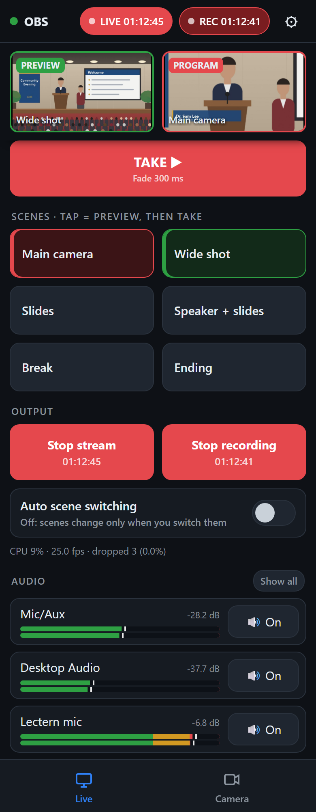
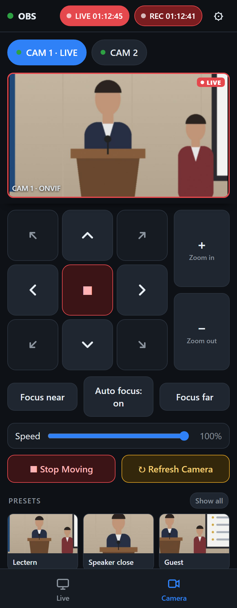
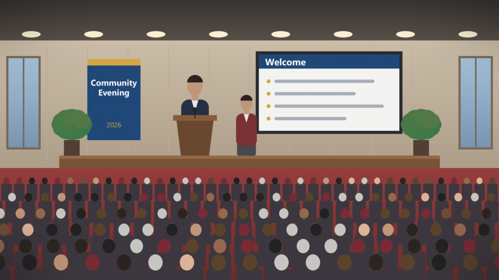

# OBS Remote assets

Pictures and mockup tools for [OBS Remote](https://github.com/mdukasa/obs-remote): screenshots for READMEs, release notes and websites.

**Everything here is made up.** The venue is a drawing, the people are shapes, and "Dr. Sam Lee" doesn't exist. There's no real camera footage, venue or person in any picture.

<p align="center">
  
  &nbsp;
  
</p>

## What's here
| Folder | Contents |
|---|---|
| `screenshots/` | Finished phone shots of the app: `live.png` and `camera.png` (780×2000, a 390 px phone at 2×), and `installer.png`, the setup window with a working QR code for `http://192.168.1.50:8765/`. |
| `venue/venue.jpg` | The whole made-up hall, 3200×1800. |
| `venue/views/` | Camera views of the hall at 1920×1080: `wide`, `stage`, `lectern`, `lectern-lower-third`, `speaker`, `guest`, `screen`, `audience`. The close-ups are enlarged crops, so they're a little soft. |
| `tools/` | The scripts that make all of the above. |

<p align="center"></p>

## Re-making them
Needs Windows, Python 3 with Pillow (`pip install pillow`), Microsoft Edge, and an [obs-remote](https://github.com/mdukasa/obs-remote) checkout next to this folder (or set `OBS_REMOTE` to its path).

```
cd tools
python pictures.py   # draws the hall -> venue/, and demo-data.js for the fake OBS
python make.py       # photographs the app and the installer -> screenshots/
```

Run `make.py` again after a UI change in obs-remote and the screenshots show the new version. The drawing is seeded, so `pictures.py` gives the same pictures every time.

## How the tools work
- **`pictures.py`** draws one large hall with Pillow and crops it the way a PTZ camera would frame it. It also writes `demo-data.js`: the views as base64 pictures, plus preset thumbnails.
- **`fake-obs.js`** replaces the browser's `WebSocket` with a pretend OBS. It answers the app's obs-websocket requests from that data: six scenes in Studio Mode, two obs-ptz cameras with presets, moving audio meters, and a live stream and recording.
- **`make.py`** loads the real app from obs-remote with the fake OBS into a 390 px frame and screenshots it with headless Edge. `installer.png` is a copy of what obs-remote's `setup/install.ps1` prints, with a real QR code from its `setup/qr.py`.

To change what the screenshots show, edit the demo data in `fake-obs.js` (scene names, cameras, presets, levels) or the views in `pictures.py`.
